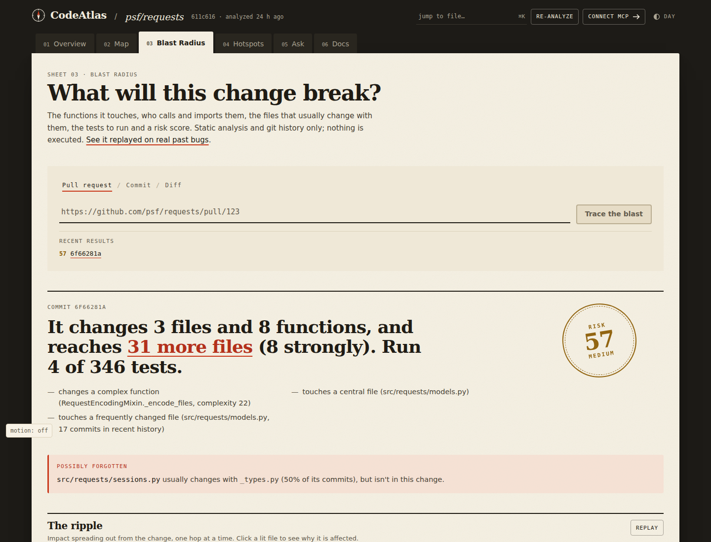
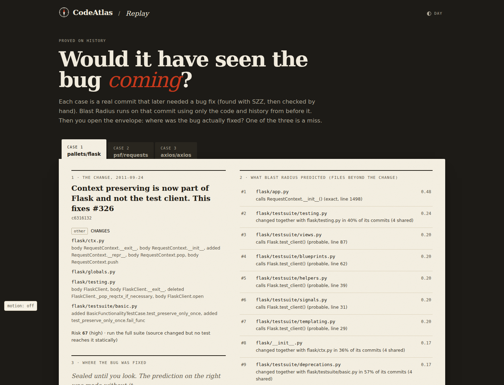
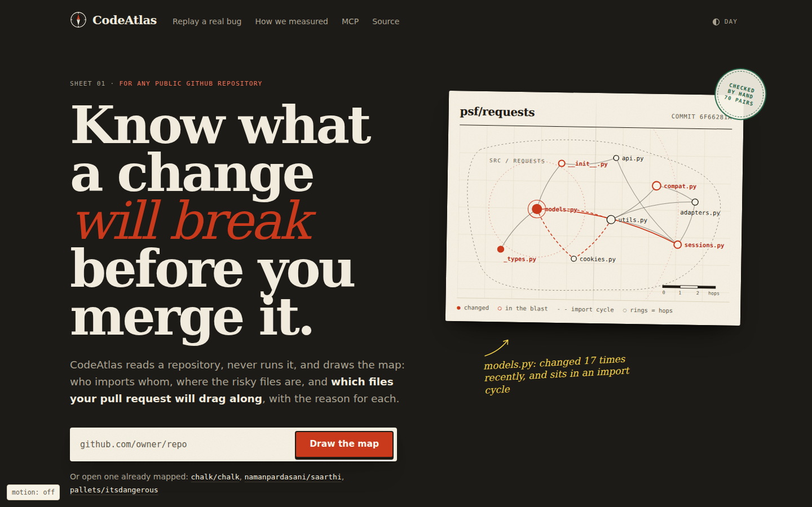
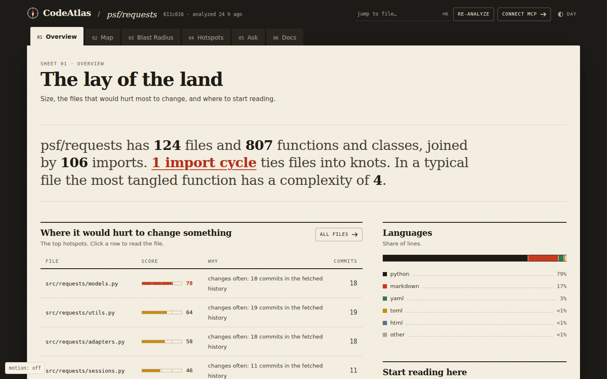
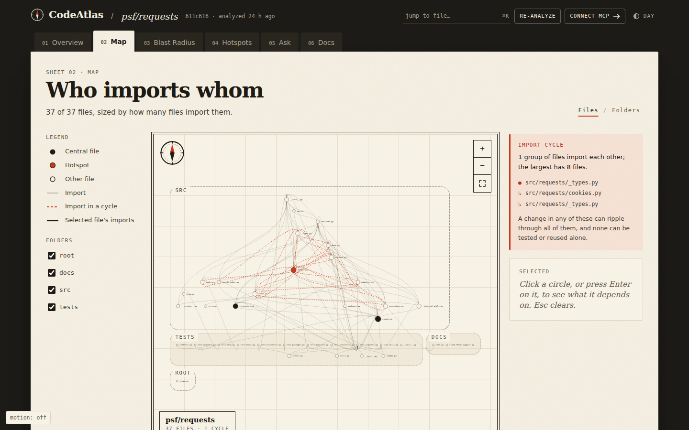
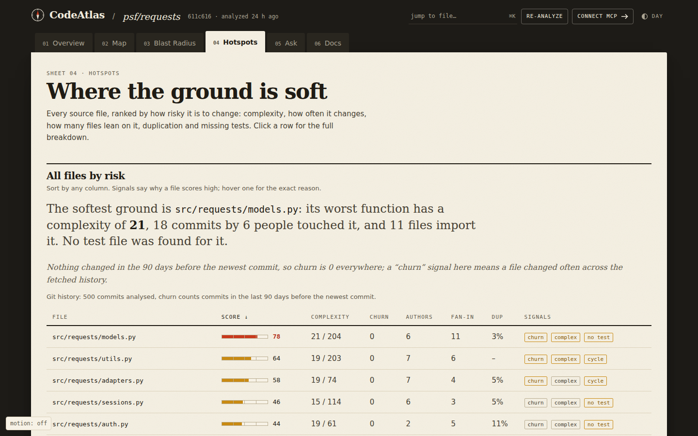
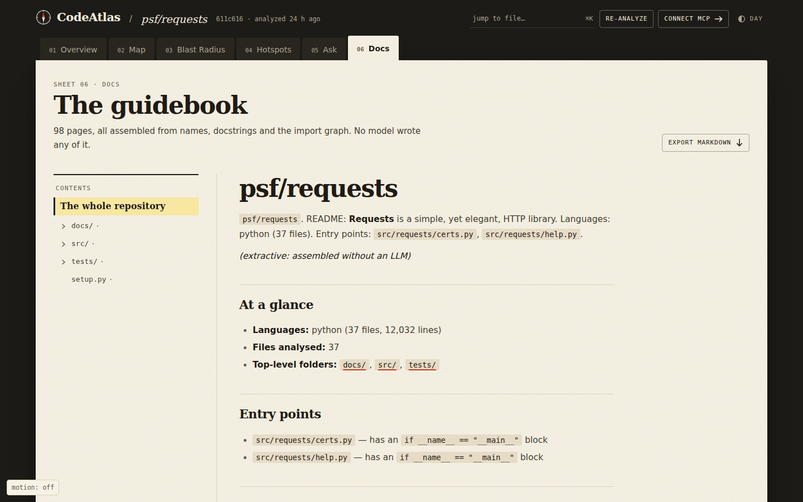
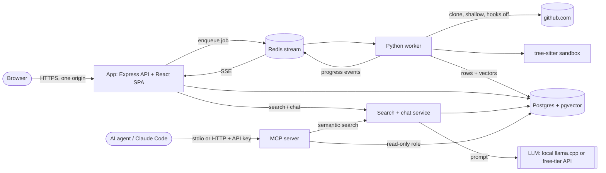

# CodeAtlas

**CodeAtlas predicts what your pull request will break, before you merge it.** Give it a PR, a commit or a diff:
**Blast Radius** finds the functions the change really touches, follows who calls them, who imports them and which files
historically change with them, explains every step, picks the tests to run, scores the risk and suggests reviewers. It
posts that as one PR comment and a non-blocking check (GitHub App), shows it as a ripple on the code map, and answers AI
agents through MCP before they edit shared code. Static analysis and git history only: repository code is never run.

Underneath it is a full codebase-intelligence platform: dependency graph and cycles, hotspot ranking, search and chat with
**verified citations**, generated documentation and incremental re-analysis.

> **Live demo:** **https://codeatlas-demo.onrender.com** (read-only, 5 pre-analysed repositories). It runs on a free server, so the first visit after idle can take up to a minute. Analysing any repository you type in runs locally or on your own server: see [docs/DEPLOYMENT.md](docs/DEPLOYMENT.md).
> **Demo video:** _placeholder: add the link after recording_
> **Scope:** public GitHub repositories only. **Private repositories are not supported.**

| | |
|---|---|
|  _Blast Radius of a real psf/requests commit_ |  _Replay: a real 2011 flask regression, predicted and revealed_ |
|  _landing_ |  _overview of psf/requests_ |
|  _dependency map: regions, a selected file, an import cycle_ |  _hotspot ranking with reasons_ |
|  _generated documentation_ | _chat with verified citations: screenshot to add (needs a running LLM)_ |

## Blast Radius: measured on real regressions

From [docs/BLAST_RADIUS_EVAL.md](docs/BLAST_RADIUS_EVAL.md): 477 bug-inducing commits mined with SZZ from psf/requests,
pallets/flask, axios, express and got, each replayed with only the history before it. **Read the caveats:** SZZ labels
are noisy (a hand check by an AI reviewer found 50% correct after filtering), and the beyond-the-diff sample is small.

| What | Result |
|---|---|
| Ranking the later-fixed file, hand-validated pairs (n=23) | MRR **0.831** vs 0.670 for "changed files only" (difference interval excludes 0) |
| Same, all pairs (n=477, noisier) | MRR 0.757 vs 0.731 (not significant); recall@5 lower (0.833 vs 0.878) |
| Fix files *beyond* the diff, top 10 (n=48) | recall@10 0.381, vs 0.414 for a same-folder heuristic (not significant) |
| Test selection (n=201 with an existing fix test) | median **6%** of the suite selected; the fix's test file included in **70%** of cases (name matching: 19%) |
| Risk score (341 held-out commits) | AUC **0.71**; lines changed alone: 0.74 |
| Speed per change, cached base (37-275-file repos) | median 0.16-0.70 s; cold 1.1-4.0 s; Django (2,978 code files): 0.14 s per change after a 41 s base build |

What drives it (ablations): co-change history carries most of the beyond-the-diff signal; the call graph mostly improves
ordering *within* the change; max combination beats noisy-OR (MRR 0.757 vs 0.633).

## Features

- **Blast Radius** (flagship): diff -> changed symbols (old/new ASTs, body fingerprints), function-level call graph with
  exact/probable/weak confidence, impact propagation with explanation paths, test selection with safe "full suite"
  fallbacks, explainable risk score, missing co-change warnings, reviewer suggestions; GitHub App, UI ripple map, Replay
  page, MCP tools. See [BLAST_RADIUS_PLAN.md](BLAST_RADIUS_PLAN.md) and the evaluation report.

- **Parsing** with tree-sitter (TypeScript, JavaScript, Python): symbols, imports, exports, complexity, in a sandboxed child process.
- **Import resolution and dependency graph**: tsconfig paths, workspaces, Python packages; cycles via strongly connected components; fan-in/out and PageRank.
- **Hotspots**: complexity, churn, centrality, cycles, duplication and missing tests combined into an explainable score.
- **Hybrid code search**: AST-aware chunks, local embeddings (bge-small), pgvector HNSW + Postgres full-text, fused with Reciprocal Rank Fusion.
- **Chat with citations**: retrieval-grounded answers; every citation is checked against the retrieved code, unsupported sentences are removed, weak evidence is refused before the model is called.
- **Generated documentation** per symbol/file/folder/repo, cached by content hash, with an honest footer and an extractive fallback.
- **Incremental re-analysis**: content-hash diff, renames detected, only changed files reprocessed; result proven equal to a full analysis by tests.
- **MCP server** (stdio + HTTP with API keys): six read-only tools for agents, read-only database role, repo-scoped access.
- **Evaluation harness**: retrieval variants, answer metrics, graph precision/recall, reproducible runs stored in the database.
- **Safety**: GitHub login, per-user daily caps, queue limit, size limits, strict clone allowlist, no repo code ever executed. See [docs/SECURITY.md](docs/SECURITY.md).

## Architecture



Pipeline per job: clone → inventory → diff against the previous run → parse → resolve imports → graph + cycles → git history →
duplicates → hotspots → facts → chunk → embed (cache by content hash) → documentation. Details in [NOTES.md](NOTES.md).

## Measured results

Every number comes from a stored run; method, run ids and caveats are in [docs/EVAL.md](docs/EVAL.md). **Read the caveat:** the 50
evaluation questions were written by the same AI that built the system, not by a human maintainer, and the sample is small.
Treat these as indicative, not as a benchmark.

| What | Result |
|---|---|
| Retrieval, hybrid search over AST chunks, 32 dev questions (4 repos) | MRR 0.481 → 0.658, recall@5 0.641 → 0.859 after the fixes |
| Same, 11 held-out questions not used to pick the fix | MRR 0.364 → 0.542, recall@10 0.682 → 0.773 |
| AST chunks vs fixed-size chunks (43 questions, hybrid) | no clear winner: hit@5 0.674 vs 0.581, MRR 0.451 vs 0.510 |
| Cross-encoder rerank | did not help (MRR 0.457 vs 0.451) |
| Dependency-edge precision / recall (104 verified edges, 4 repos) | 0.945 → 1.000 / 1.000 (mostly simple imports) |
| Incremental re-analysis, psf/requests (124 files), 5-file change | 1.67 s vs 238 s full with cold vector cache, vs 3.06 s full with warm cache |
| Answer quality (local 1.5B model) | not reported: the free local judge failed; see EVAL.md |
| Tests | 929 automated tests (811 worker, 86 API, 32 MCP) |

## Quick start (local, free)

Requires Docker, Node 22, Python 3.12 + [uv](https://docs.astral.sh/uv/).

```bash
cp .env.example .env                       # set passwords
docker compose up -d postgres redis
bash scripts/migrate.sh                    # or: cd workers/analyzer && uv run python -m analyzer.migrate

# three terminals
cd workers/analyzer && uv run python -m analyzer.main        # worker
cd apps/api && npm ci && npx tsx src/server.ts               # API on :4000
cd apps/web && npm ci && npm run dev                         # UI on :5173
# optional: semantic search + chat
cd workers/analyzer && uv run python -m analyzer.service
```

Everything in containers: `docker compose --profile app up --build` (UI + API on http://localhost:4000).
Chat needs an LLM: set `LLM_PROVIDER=llamacpp` (local, free) or a free-tier key (`groq`, `gemini`, `openrouter`). Paid providers
refuse to run without `LLM_ALLOW_PAID=1`.

Hosted demo and free-tier limits: [docs/DEPLOYMENT.md](docs/DEPLOYMENT.md).

## MCP server (for Claude Code and other agents)

```bash
cd apps/mcp && npm ci
MCP_DB_PASSWORD='<long random>' npx tsx src/admin.ts setup-role      # read-only database role (once)
claude mcp add codeatlas -- "$PWD/bin/codeatlas-mcp.sh"              # stdio
```

Tools: `get_architecture`, `find_symbol`, `get_dependencies`, `get_hotspots`, `explain_file`, `search_code`, and for Blast
Radius `get_blast_radius`, `suggest_tests`, `check_change_risk`. Remote HTTP with
API keys, threat model and example prompts: [docs/MCP.md](docs/MCP.md).

## Tech stack

React + TypeScript + Vite + Tailwind v4 (tokens and shared components) · Node 22 + Express 5 + zod · Python 3.12 worker
(tree-sitter, networkx, fastembed) · Postgres 16 + pgvector (HNSW) + full-text · Redis streams · MCP TypeScript SDK 1.32 ·
llama.cpp / any OpenAI-compatible provider · GitHub Actions · Docker.

## Limitations (honest list)

- Public GitHub repositories only; no private repos, no GitLab/Bitbucket.
- Languages: TypeScript, JavaScript and Python are parsed; other languages are inventoried but not analysed in depth.
- The free hosted demo is read-only (no worker is available on free tiers); chat and semantic search need the local stack.
- Evaluation is small and AI-authored; answer quality has no trustworthy automatic score yet (a human spot-check sheet is waiting in `eval/spotcheck.csv`).
- Generated summaries are screened but can still be wrong; they are labelled model-written or extractive.
- Largest repository analysed so far: 124 source files (psf/requests). Scaling beyond a few thousand files is untested.
- Prompt injection through repository text is mitigated, not eliminated ([docs/SECURITY.md](docs/SECURITY.md)).

## Documentation

[NOTES.md](NOTES.md) (architecture, decisions, failure modes, interview Q&A) · [docs/BLAST_RADIUS_EVAL.md](docs/BLAST_RADIUS_EVAL.md) · [docs/EVAL.md](docs/EVAL.md) · [docs/MCP.md](docs/MCP.md) ·
[docs/SECURITY.md](docs/SECURITY.md) · [docs/DEPLOYMENT.md](docs/DEPLOYMENT.md) · [docs/RESUME.md](docs/RESUME.md) · [docs/WALKTHROUGH.md](docs/WALKTHROUGH.md)
